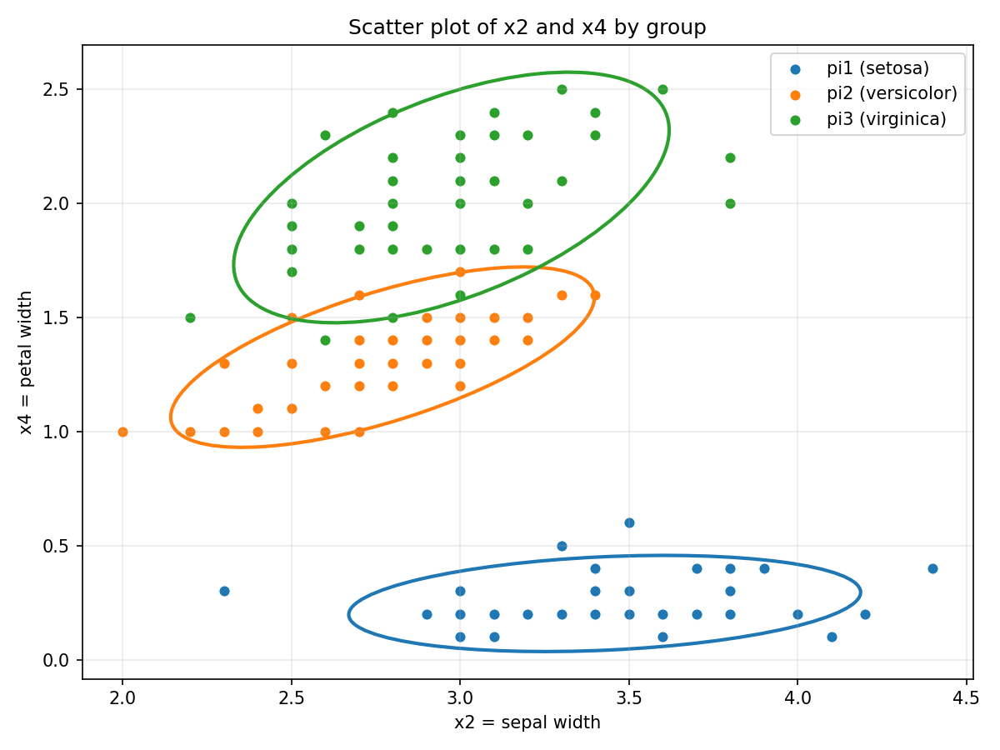
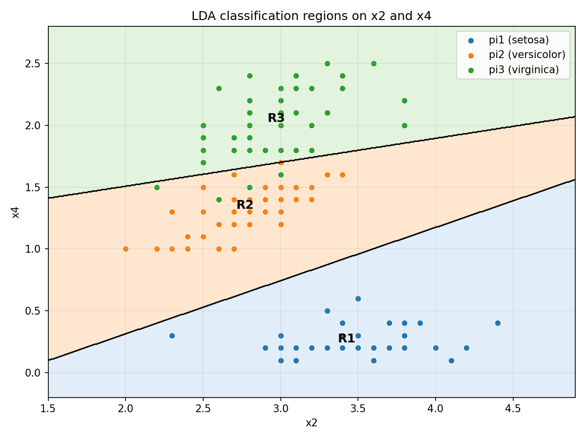

# 教材第 11.12 题：Fisher-Anderson Iris 数据判别分析报告

## 一、数据说明

本题使用 `sklearn.datasets.load_iris` 直接加载 Fisher-Anderson Iris 数据集，不读取外部 CSV 文件。

类别对应关系如下：

| 原始类别 | 记号 |
|---|---|
| setosa | pi1 |
| versicolor | pi2 |
| virginica | pi3 |

变量对应关系如下：

| 变量 | 含义 |
|---|---|
| x1 | sepal length |
| x2 | sepal width |
| x3 | petal length |
| x4 | petal width |

样本量为：

| 类别 | 样本数 |
|---|---:|
| pi1 | 50 |
| pi2 | 50 |
| pi3 | 50 |
| 总计 N | 150 |

分析脚本位置：

```bash
exercises/iris_discriminant_11_12.py
```

运行方式：

```bash
python exercises/iris_discriminant_11_12.py
```

---

## (a) x2-x4 散点图与协方差椭圆

在 `(x2, x4)` 平面上绘制三组样本点，并按类别着色，同时为每一组绘制样本协方差椭圆。



从图形和 `x4` 的取值范围看：

| 类别 | x4 最小值 | x4 最大值 |
|---|---:|---:|
| pi1 | 0.1000 | 0.6000 |
| pi2 | 1.0000 | 1.8000 |
| pi3 | 1.4000 | 2.5000 |

结论：

- 三组在 `(x2, x4)` 平面上总体明显可分。
- `pi1` 与另外两组分离非常明显。
- `pi2` 与 `pi3` 在边界附近存在少量重叠。

对 `(x2, x4)` 的组内二元正态性，脚本使用 Mardia 偏度和峰度进行近似检查：

| 类别 | skew p-value | kurt p-value | 是否近似二元正态 |
|---|---:|---:|---|
| pi1 | 0.0139 | 0.0229 | 否 |
| pi2 | 0.0445 | 0.7538 | 否 |
| pi3 | 0.5560 | 0.9287 | 是 |

因此，严格检验下至少一组不完全支持二元正态假设；但从散点图和协方差椭圆形态看，判别分析仍可作为近似方法使用。

---

## (b) MANOVA 检验与 Box's M 检验

检验问题为：

```text
H0: mu1 = mu2 = mu3
H1: 至少有一个均值向量不同
```

使用 MANOVA 得到四个多元检验统计量：

| 检验统计量 | Value | F Value | p-value |
|---|---:|---:|---:|
| Wilks' Lambda | 0.0234 | 199.1453 | 1.36501e-112 |
| Pillai Trace | 1.1919 | 53.4665 | 9.74216e-53 |
| Hotelling-Lawley Trace | 32.4773 | 582.1970 | 1.07742e-135 |
| Roy Largest Root | 32.1919 | 1166.9574 | 3.78730e-109 |

在显著性水平 `alpha = 0.05` 下，四个检验的 p-value 均远小于 0.05，因此拒绝 `H0`。

结论：三组 Iris 样本的总体均值向量存在显著差异。

### Box's M Test

检验问题为：

```text
H0: Sigma1 = Sigma2 = Sigma3
H1: 至少有两个总体协方差矩阵不同
```

Box's M 统计量计算公式为：

```text
M = (N - k) ln|Sp| - sum(ni - 1) ln|Si|
```

脚本进一步使用卡方近似检验，结果如下：

| 指标 | 数值 |
|---|---:|
| Box's M | 146.6632 |
| Chi-square | 140.9430 |
| df | 20 |
| p-value | 3.35203e-20 |

由于 p-value 远小于 0.05，因此拒绝协方差矩阵相等假设。

结论：三组总体协方差矩阵不宜认为相等，因此从假设角度看，更倾向使用 QDA。

---

## (c) QDA：四变量二次判别

本小问假设：

```text
Sigma1 != Sigma2 != Sigma3
p1 = p2 = p3 = 1/3
```

二次判别函数为：

$$
d_i^Q(x) = -0.5 ln|Si| - 0.5(x - mui)' Si^{-1} (x - mui) + ln(pi)
$$
对给定观测：

```text
x0 = [3, 5.1, 7.5, 2]
```

得到三个类别的 QDA 判别得分：

| 类别 | QDA score |
|---|---:|
| pi1 setosa | -852.4316 |
| pi2 versicolor | -234.9297 |
| pi3 virginica | -227.2675 |

最大得分对应 `pi3`。

结论：

```text
x0 被 QDA 分类为 pi3，即 virginica。
```

---

## (d) LDA：四变量线性判别

本小问假设：

```text
Sigma1 = Sigma2 = Sigma3 = Sigma
p1 = p2 = p3 = 1/3
```

线性判别函数为：

```text
d_i^L(x) = x' Sp^{-1} mui - 0.5 mui' Sp^{-1} mui + ln(pi)
```

四变量合并协方差矩阵 `Sp` 为：

|  | x1 | x2 | x3 | x4 |
|---|---:|---:|---:|---:|
| x1 | 0.2650 | 0.0927 | 0.1675 | 0.0384 |
| x2 | 0.0927 | 0.1154 | 0.0552 | 0.0327 |
| x3 | 0.1675 | 0.0552 | 0.1852 | 0.0427 |
| x4 | 0.0384 | 0.0327 | 0.0427 | 0.0419 |

对同一个观测：

```text
x0 = [3, 5.1, 7.5, 2]
```

得到三个类别的 LDA 判别得分：

| 类别 | LDA score |
|---|---:|
| pi1 setosa | -53.4044 |
| pi2 versicolor | 62.2662 |
| pi3 virginica | 89.6715 |

最大得分对应 `pi3`。

结论：

```text
x0 被 LDA 分类为 pi3，即 virginica。
```

与 (c) 的 QDA 结果比较：

- QDA 分类结果：`pi3`
- LDA 分类结果：`pi3`
- 两者分类结果一致。

方法选择说明：

- 如果 Box's M 检验拒绝协方差齐性，应更倾向使用 QDA。
- 如果 Box's M 检验不拒绝协方差齐性，应更倾向使用 LDA。
- 本题 Box's M 检验拒绝协方差齐性，因此本数据更倾向使用 QDA。

---

## (e) 二维 LDA 分类区域

本小问仅使用变量：

```text
(x2, x4)
```

三组样本均值为：

| 类别 | x2 | x4 |
|---|---:|---:|
| pi1 | 3.4280 | 0.2460 |
| pi2 | 2.7700 | 1.3260 |
| pi3 | 2.9740 | 2.0260 |

二维合并协方差矩阵为：

|  | x2 | x4 |
|---|---:|---:|
| x2 | 0.1154 | 0.0327 |
| x4 | 0.0327 | 0.0419 |

对给定点：

```text
x0_pair = [5.1, 2]
```

三个类别的二维 LDA 得分为：

| 类别 | LDA score |
|---|---:|
| pi1 setosa | 79.0819 |
| pi2 versicolor | 92.7912 |
| pi3 virginica | 90.6727 |

最大得分对应 `pi2`。

结论：

```text
x0_pair 被二维 LDA 分类为 pi2，即 versicolor。
```

二维 LDA 分类区域如下图所示。背景颜色表示分类区域，散点为原始观测，黑色曲线为决策边界。



---

## (f) APER 与 E(AER)

本小问使用 (d) 的四变量 LDA。

### APER

将全部样本用于训练并回代分类，得到混淆矩阵：

|  | pred_pi1 | pred_pi2 | pred_pi3 |
|---|---:|---:|---:|
| actual_pi1 | 50 | 0 | 0 |
| actual_pi2 | 0 | 48 | 2 |
| actual_pi3 | 0 | 1 | 49 |

分类结果：

| 指标 | 数值 |
|---|---:|
| 正确分类数 | 147 |
| 错误分类数 | 3 |
| APER | 0.0200 |

### LOOCV 估计 E(AER)

使用 Leave-One-Out Cross Validation 得到混淆矩阵：

|  | pred_pi1 | pred_pi2 | pred_pi3 |
|---|---:|---:|---:|
| actual_pi1 | 50 | 0 | 0 |
| actual_pi2 | 0 | 48 | 2 |
| actual_pi3 | 0 | 1 | 49 |

交叉验证结果：

| 指标 | 数值 |
|---|---:|
| LOOCV 错误分类数 | 3 |
| E(AER) | 0.0200 |

结论：四变量 LDA 在 Iris 数据上的分类错误率很低，回代错误率和 LOOCV 估计错误率均为 `0.0200`。

---

## 总结

1. 在 `(x2, x4)` 平面上，`pi1` 与其他两组明显分离，`pi2` 与 `pi3` 有少量重叠。
2. MANOVA 在 `alpha = 0.05` 下拒绝三组均值向量相等，说明三类 Iris 的四维均值向量存在显著差异。
3. Box's M 检验拒绝协方差矩阵相等假设，因此从模型假设角度更倾向 QDA。
4. 对 `x0 = [3, 5.1, 7.5, 2]`，QDA 与四变量 LDA 均分类为 `pi3 (virginica)`。
5. 仅使用 `(x2, x4)` 的二维 LDA 时，`x0_pair = [5.1, 2]` 被分类为 `pi2 (versicolor)`。
6. 四变量 LDA 的 `APER = 0.0200`，LOOCV 估计的 `E(AER) = 0.0200`，说明分类效果较好。
